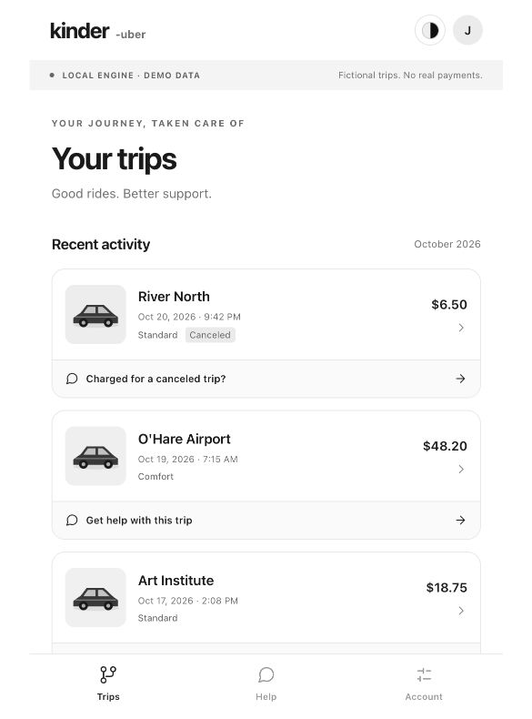

# kinder-uber

A stateful ride-support application built with **Python, FastAPI, Vue 3, SQLite, ChromaDB and MCP**. Trip records, rider corrections, evidence, simulated adjustments and specialist handoff stay in one case.

Single agent with durable case context is the default. Adaptive multi-agent routing is an explicit option with the same read-only tools. Multiple agents are not presented as a quality improvement. The local demo uses a deterministic model adapter and requires no model API key.

Independent prototype, not affiliated with Uber. Supplied trips and policies are fictional; no real payment is executed.



## Run

On macOS, double-click `Start kinder-uber.command`, or run:

```bash
bash scripts/one-click.sh start --no-open
bash scripts/one-click.sh status
bash scripts/one-click.sh stop
```

Open [Trips](http://127.0.0.1:5175/#/trips), [Help](http://127.0.0.1:5175/#/help) or [Account](http://127.0.0.1:5175/#/account). First setup needs Python 3.11/3.12, Node.js compatible with Vite 7, and dependency-registry access. The background installation supervises the frontend, backend and separate stdio MCP process. The Mac must remain awake and logged in. Run Start again after source updates; saved cases are retained.

For foreground development, stop the background installation, then run `bash scripts/run-rides.sh --dev`.

## Use

Select a trip, describe a dispute, add evidence, review a proposed simulated adjustment or request a specialist. A specialist can read the existing history, accept the case and record a decision.

**Support approach** on Account, new-case and conversation screens selects the next analysis. Single agent is the default; multi-agent is optional. Both keep durable context. An explicit browser preference survives reload. Each case and execution records its actual mode.

API clients can pass `agent_mode: "single"` or `"multi"` on case creation or a `message` action. Omitting it defaults new/older cases to single and preserves an existing explicit case choice on follow-ups. State changes use request IDs and case revisions; model text cannot execute payments.

## Structure

| Path | Responsibility |
|---|---|
| `backend/mobility/` | Active ride API, workflow guards, persistence, execution, context and operational controls |
| `backend/agents/`, `backend/core/` | Agent execution, intent recognition, access and concurrency primitives |
| `backend/memory/`, `backend/tooling/` | Conversation memory, policy retrieval, tool guards and MCP transport |
| `backend/evaluation/`, `backend/monitor/` | Runnable evaluation and monitoring components |
| `backend/skills/` | Runtime instructions loaded by the engine; `SKILL.md` files are required inputs |
| `frontend/` | Vue mobile rider interface, specialist desk and control room |
| `datasets/ride_support_v1/` | Synthetic catalog, 1,000 worlds, 2,000 dialogue variants and separate scorer labels |
| `legacy-java/` | Separate Java 21 service; does not serve the active mobile ride API |
| `scripts/` | Launchers, provisioning, recovery, replay and deployment tools |

The application receives catalog records. Scenario steps and oracle labels are consumed by replay/scoring tools, not by the agent. Related dialogue variants stay in the same split. Synthetic results do not establish real-user accuracy.

## Develop

```bash
python -m pip install --require-hashes -r backend/requirements.txt
python -m pip install -r backend/requirements-dev.txt
(cd backend && python -m pytest tests -q)
(cd frontend && npm ci && npm test && npm run lint && npm run build)
```

For the separate Java service, use JDK 21 and run `(cd legacy-java && ./mvnw clean test)`. `python scripts/check-java.py --with-chroma` starts isolated Redis/Chroma/MCP dependencies for additional integration coverage; it requires `redis-server` and the Python dependencies.

Replay the supplied synthetic data through the real API pipeline:

```bash
cd backend
python -m mobility.simulation audit --dataset ../datasets/ride_support_v1
python -m mobility.simulation replay --dataset ../datasets/ride_support_v1 --output ../artifacts/my-replay
```

Existing dataset/result directories are never overwritten. Generated results, databases, credentials, caches and build output stay outside the tracked tree.

## Optional authenticated and container previews

```bash
python scripts/provision-auth-preview.py
bash scripts/run-authenticated-demo.sh
```

Open `http://127.0.0.1:8012`. Generated fictional credentials are stored in the owner-only, ignored `.runtime/auth-preview/access-credentials.json`. They expire after 24 hours; browser sign-in holds them in memory only. For rotation, provision a new `--output` directory and pass it to the run script; existing registries are not overwritten.

With Docker Engine and Compose, `bash scripts/container-demo.sh` starts a separate authenticated preview on `http://127.0.0.1:8013`. Read the required account credential locally:

```bash
docker compose --profile tools run --rm --no-deps init python -c \
  'import json; print(json.load(open("/config/profile/access-credentials.json"))["credentials"]["preview-rider"])'
```

Other preview accounts are `preview-specialist` and `preview-operator`. Keep credentials out of screenshots, URLs and source control. Container rotation requires a newly provisioned configuration directory selected through a Compose override. `docker compose stop app` preserves state; removing volumes deletes it.

## Runtime boundaries

The default public demo identities are role-play controls. Keep demo mode on loopback. The authenticated preview enforces ownership and staff roles, but is not managed identity or OIDC. Storage is single-node SQLite with embedded Chroma; use one worker per state namespace. Real deployments still need TLS, identity lifecycle management, upload scanning, dependency review and offsite recovery. No production availability or live-model quality claim is made.

`/livez` checks the process; `/readyz` also checks storage, policy indexes, projections and actual MCP access. Local data lives under `.runtime/`; the persistent macOS installation uses `~/Library/Application Support/kinder-uber/<instance>/`. Use `python -m mobility.backup --help` from `backend/` for offline backup/restore commands and stop the relevant instance before copying embedded state.

Live model access is separate from agent count: set `KINDER_UBER_RIDE_MODEL_MODE=live`, `KINDER_UBER_RIDE_MODEL` and `KINDER_UBER_RIDE_API_KEY` explicitly. The default remains no-key `demo`; live model access never grants financial permissions.
