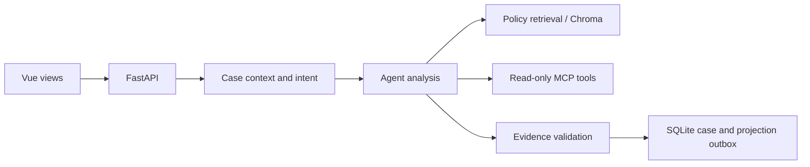

# LLM-Agent-System

[](https://github.com/lucia-huang7/LLM-Agent-System/actions/workflows/verify.yml)

A Python/FastAPI support agent with durable case memory, policy retrieval and read-only MCP tools, backed by SQLite and Chroma. A Vue web client provides rider, specialist and operator views.

The engineering problem is preserving an evolving account of a dispute: a rider can correct a statement, contradict the trip record and request an adjustment in the same conversation. The system stores rider claims separately from recorded facts, attaches policy evidence to its analysis, and hands the existing case to a specialist. An adjustment is a server-controlled state transition requiring explicit rider confirmation; model output cannot execute it.


[All 25 interface screens](docs/interface.md) · [Editable presentation](docs/assets/device-showcase.html). The phone frames are presentation artwork; the application runs in a browser.

## Run

Use Python 3.11/3.12 and Node.js compatible with Vite 7. The default deterministic adapter needs no model API key. Trips, policies and payments are fictional; Uber is not contacted.

```bash
git clone https://github.com/lucia-huang7/LLM-Agent-System.git
cd LLM-Agent-System
bash scripts/dev/one-click.sh start --no-open
```

On macOS, open [Trips](http://127.0.0.1:5175/#/trips), or double-click [Start LLM-Agent-System.command](scripts/macos/Start%20LLM-Agent-System.command). The launcher supervises the API, frontend and independent stdio MCP process. For foreground development on other systems, run `bash scripts/dev/run-rides-dev.sh` after installing the dependencies below. [Operations](docs/operations.md) covers stopping, authenticated previews, containers, backup and optional live-model configuration.

## Design



Single agent with durable memory is the default. Optional multi-agent routing is retained for comparison; it produced no completion gain in the offline experiment. Both modes use scoped tools and the same validation and case-transition rules.

| Code | Responsibility |
|---|---|
| [API](backend/ride_agent/api/) | Identity, ownership, request bounds, revisions and HTTP routes |
| [Agent pipeline](backend/ride_agent/agent/pipeline.py) | Context restoration, intent, analysis, scoped tools and evidence validation |
| [Domain](backend/ride_agent/domain/) | Versioned rider claims, catalog facts and guarded case transitions |
| [Persistence](backend/ride_agent/persistence/) | Atomic case/receipt commits, immutable attachments, projection outbox and recovery |
| [Retrieval](backend/ride_agent/retrieval/) / [integrations](backend/ride_agent/integrations/) | Policy indexes, model adapters and standard MCP client/server boundary |
| [Frontend](frontend/src/) | Rider workflow, specialist desk and operator diagnostics |

Request IDs make command retries idempotent; revisions and ETags reject stale writes. SQLite is authoritative. Chroma indexes are derived state updated through the durable outbox, so an indexing failure does not silently rewrite the committed case.

## Evaluation

The [dataset](datasets/ride_support_v1/) contains 1,000 synthetic worlds and 2,000 dialogue variants across eight failure families. Both variants of a world stay in one split: development 581 worlds/1,162 dialogues, calibration 217/434, test 202/404. Replay exercises the actual HTTP pipeline; oracle labels remain outside agent inputs.

| Agent mode | Context | Strict completion | Context loss per eligible checkpoint | Median dialogue |
|---|---|---:|---:|---:|
| Single | Recent 4 rider rounds | 1,340/2,000 · 67.00% | 34.09% | 406.6 ms |
| Multi | Recent 4 rider rounds | 1,340/2,000 · 67.00% | 34.09% | 422.3 ms |
| Single (default) | Durable | 2,000/2,000 · 100.00% | 0.00% | 380.1 ms |
| Multi (optional) | Durable | 2,000/2,000 · 100.00% | 0.00% | 392.2 ms |

These are deterministic offline measurements of memory retention and workflow conformance, not LLM reasoning or real-user accuracy. Conditions ran concurrently on a shared host with overlapping local validation; latency is not an isolated performance comparison. [Frozen source/data hashes, per-split and family results, failures and paired comparisons](datasets/ride_support_v1/baseline.json) identify the exact measured version. Live-model quality, latency and cost have not been measured.

```bash
python scripts/bench/run-ablation.py --output artifacts/my-ablation
python scripts/ops/check-evaluation-evidence.py
```

The runner refuses existing output directories and preserves raw responses, failures and source hashes. [Reproduction details](docs/operations.md#reproduce-the-offline-comparison) explain the four conditions and explicit live-evaluation harness. Benchmarks and reliability workloads live in `scripts/bench/`; synthetic generation, audit, replay and scoring live in `backend/ride_agent/evaluation/simulation/`.

## Develop

```bash
python -m pip install --require-hashes -r backend/requirements.txt
python -m pip install -r backend/requirements-dev.txt
(cd backend && python -m pytest tests -q -W error)
(cd frontend && npm ci && npm run lint && npm run format:check && npm test && npm run build)
```

CI runs these checks and validates the published evaluation evidence on main pushes and pull requests. Generated databases, credentials, raw experiment output and build artifacts are ignored by Git.

## Limits

- Synthetic fixtures and the local adapter do not establish live-model reliability. Independent human review of the generated dataset is pending.
- Offline correction extraction is conservative and field-based; arbitrary corrections can remain unstructured. Original messages are retained for specialist review.
- The system supports one worker per SQLite/embedded-Chroma state namespace. It does not implement a distributed runtime.
- Demo identities are role-play controls. An authenticated preview exists, but public deployment still needs managed identity, TLS, upload scanning and offsite recovery.
- Adjustments are simulated. No real payment integration or production availability claim is made.
