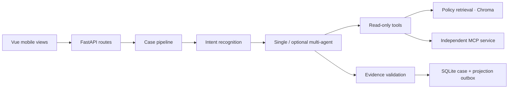

# LLM-Agent-System: Stateful Ride-Support Agent

A support agent where rider claims stay separate from recorded trip facts, policy answers carry retrieved evidence, and model text cannot execute an adjustment.


## Why this is hard

A rider can correct an earlier statement, contradict a recorded pickup, and request a refund in the same conversation. A useful support system must preserve the correction, distinguish claims from facts, retrieve the applicable policy, and hand the case to a specialist without losing its history.

## Architecture



The [API](backend/ride_agent/api/app.py) assembles middleware, lifespan management and route groups. The [pipeline](backend/ride_agent/agent/pipeline.py) loads case context, recognizes intent, builds scoped tools, orchestrates the analysis, validates evidence and prepares durable memory effects. [Case transitions](backend/ride_agent/domain/case.py) apply separate server-controlled commands; analysis never grants financial authority.

The [claim ledger](backend/ride_agent/domain/claims.py) records statement versions and corrections independently of trip records. [Memory](backend/ride_agent/agent/memory.py) restores the case snapshot and derives source-backed context. [Persistence](backend/ride_agent/persistence/store.py) commits case changes and projection work together; Chroma indexes remain derived state.

## Key design decisions

| Decision | Reason | Implementation |
|---|---|---|
| Separate rider claims and recorded facts | A corrected statement must not silently overwrite verified trip data | [Claim ledger](backend/ride_agent/domain/claims.py) |
| Require indexed policy anchors | Missing payment or topic evidence downgrades the analysis to partial | [Policy validation](backend/ride_agent/agent/pipeline.py), [case tools](backend/ride_agent/agent/case_tools.py) |
| Isolate adjustments from model output | Only a valid server proposal and explicit rider confirmation can change simulated payment state | [Case workflow](backend/ride_agent/domain/case.py) |
| Request IDs plus revisions and ETags | Retries must not duplicate an adjustment; stale writes must be rejected | [Case routes](backend/ride_agent/api/routes/cases.py), [store](backend/ride_agent/persistence/store.py) |
| Default to one agent with durable memory | Multiple agents added latency without task-completion gains in the offline comparison | [Orchestrator](backend/ride_agent/agent/orchestrator.py) |
| Keep oracle labels outside agent inputs | Evaluation answers must not enter the production request pipeline | [Replay and oracle](backend/ride_agent/evaluation/simulation/) |

## Evaluation

The supplied dataset contains **1,000 synthetic worlds and 2,000 dialogue variants across eight failure families**. Both variants of a world remain in one development, calibration or test split. Replay sends requests through the real API; a separate oracle scores the resulting records.

The following are **historical frozen offline measurements**, taken before this repository restructuring. Each condition ran all 2,000 dialogues. The deterministic model adapter requires no API key; the measured latency includes local processing, not hosted-model inference. [Recorded metrics, split counts and evidence hashes](datasets/ride_support_v1/baseline.json).

| Agent mode | Memory | Strict task completion | Context loss per eligible checkpoint | Median dialogue time |
|---|---|---:|---:|---:|
| Single | Recent 4 rider rounds | 1,340/2,000 · 67% | 34.09% | 408.2 ms |
| Multi | Recent 4 rider rounds | 1,340/2,000 · 67% | 34.09% | 498.9 ms |
| **Single (default)** | **Durable** | **2,000/2,000 · 100%** | **0%** | **382.6 ms** |
| Multi (optional) | Durable | 2,000/2,000 · 100% | 0% | 456.3 ms |

The held-out test split contains 175 worlds / 350 dialogues: recent-window conditions completed 234/350; durable conditions completed 350/350. Multiple agents produced no completion improvement under either memory condition.

Limitations:

- Synthetic fixtures and a deterministic adapter do not establish real-user accuracy, live-model reliability or universal policy grounding.
- Business invariants passed in these runs, but this is not a general safety guarantee. No real payment was executed.
- SQLite and embedded Chroma target one state namespace and one worker; deployment needs managed identity, TLS, upload scanning and offsite recovery.

## Quickstart

Requires Python 3.11/3.12 and Node.js compatible with Vite 7. First setup downloads pinned dependencies.

```bash
git clone https://github.com/lucia-huang7/LLM-Agent-System.git
cd LLM-Agent-System
bash scripts/dev/one-click.sh start --no-open
```

Open [Trips](http://127.0.0.1:5175/#/trips). On macOS, double-click [Start LLM-Agent-System.command](scripts/macos/Start%20LLM-Agent-System.command). Frontend, backend and the independent MCP process run under the local supervisor. No model API key is required. See [operations](docs/operations.md) for stopping, development, authenticated previews, containers, backup and optional live-model configuration.

## Repository layout

```text
backend/ride_agent/  api · domain · agent · retrieval · integrations · persistence · ops · evaluation
backend/tests/       unit · integration · regression
datasets/            synthetic worlds, dialogue steps, separate oracle and recorded baseline
frontend/src/        Vue Router views, workspace composable and shared components/styles
scripts/             dev · ops · bench · macos
docs/                screenshot and operations guide
```

Java is preserved on the [`archive/java`](https://github.com/lucia-huang7/LLM-Agent-System/tree/archive/java/legacy-java) branch and does not serve this application.

Independent prototype; fictional trips and policies. Not affiliated with Uber.
