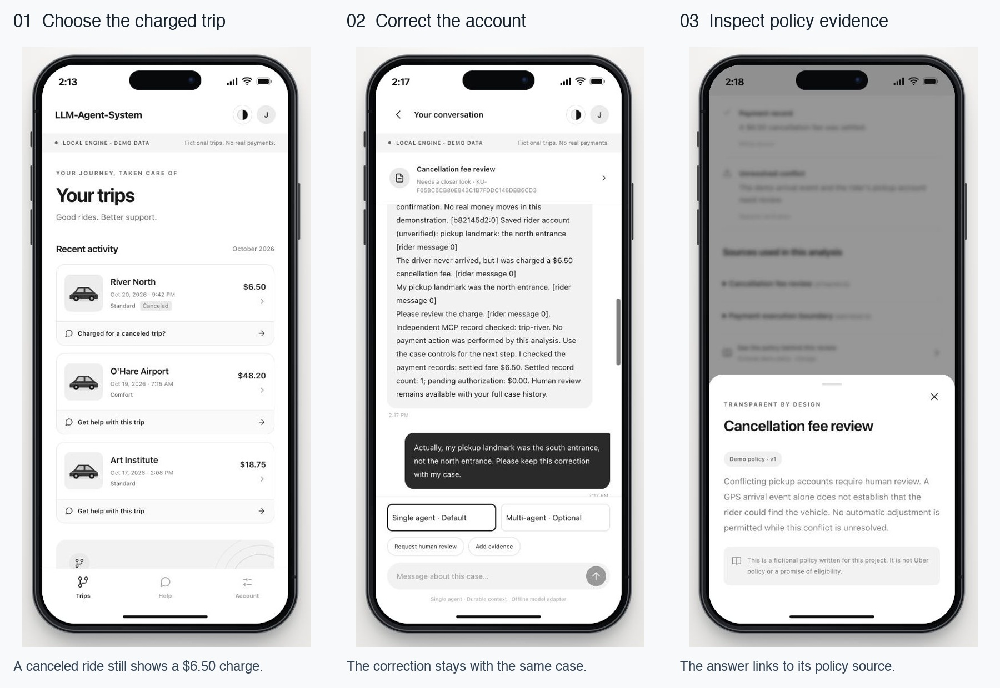
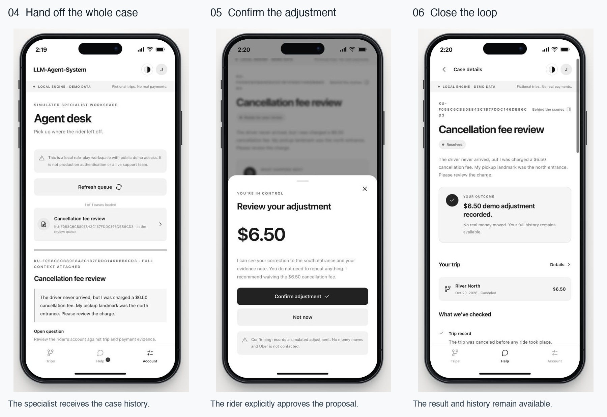
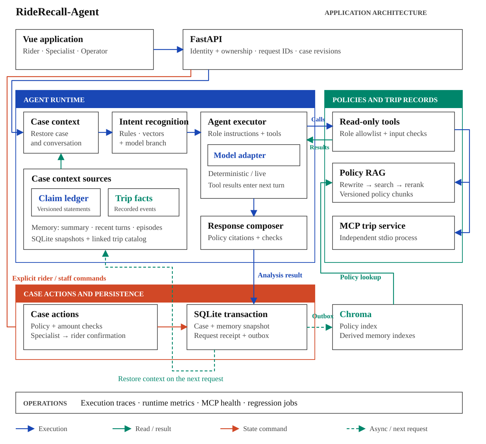

# RideRecall-Agent

[](https://github.com/lucia-huang7/RideRecall-Agent/actions/workflows/verify.yml)

A ride-support application built with Python, FastAPI, Vue, SQLite, Chroma and MCP. Riders dispute charges, correct earlier statements and request specialist review. Specialists receive the existing conversation, evidence and claim history.

[](docs/assets/story-row-1.jpg)

[](docs/assets/story-row-2.jpg)

Click either row to enlarge it. [All 25 screens](docs/interface.md).

## Architecture

[](docs/assets/architecture.svg)

- [Case memory](backend/ride_agent/agent/memory.py) restores the conversation and [versioned rider claims](backend/ride_agent/domain/claims.py). Corrections update the rider's account without replacing recorded trip facts.
- The [agent pipeline](backend/ride_agent/agent/pipeline.py) identifies the request, retrieves policies from Chroma and checks trip records through [read-only MCP tools](backend/ride_agent/integrations/mcp_server.py). Responses include policy citations.
- [Case actions](backend/ride_agent/domain/case.py) handle specialist decisions and rider confirmation. Before recording an adjustment, the server checks the amount, current policy and trip record.
- [SQLite storage](backend/ride_agent/persistence/store.py) saves case changes and request receipts in one transaction. Request IDs prevent duplicate commands; revisions reject stale writes. An [outbox](backend/ride_agent/persistence/projections.py) retries Chroma updates after the case is saved.

On 2,000 synthetic dialogues, durable memory raised strict offline workflow completion from 67% with four recent rider rounds to 100%; context loss fell from 4,100/12,026 eligible checkpoints to zero. The replay uses the deterministic adapter and measures case state and retained claims. [Results and frozen hashes](datasets/ride_support_v1/baseline.json) · [Reproduction](docs/operations.md#reproduce-the-offline-comparison).

## Run locally

Requires Python 3.11/3.12 and Node.js compatible with Vite 7. No API key is needed for the demo.

```bash
git clone https://github.com/lucia-huang7/RideRecall-Agent.git
cd RideRecall-Agent
bash scripts/dev/one-click.sh start --no-open
```

On macOS, open [Trips](http://127.0.0.1:5175/#/trips), or double-click [Start RideRecall-Agent.command](scripts/macos/Start%20RideRecall-Agent.command). The launcher supervises the frontend, API and MCP process. For foreground development, run `bash scripts/dev/run-rides-dev.sh`.

Install dependencies and run the checks:

```bash
python -m pip install --require-hashes -r backend/requirements.txt
python -m pip install -r backend/requirements-dev.txt
(cd backend && python -m pytest tests -q -W error)
(cd frontend && npm ci && npm run lint && npm run format:check && npm test && npm run build)
```

CI runs 321 backend tests, 22 frontend tests, lint, build and evaluation-evidence checks. [Operations](docs/operations.md) covers service control, authenticated previews, containers, backup and live-model configuration.

Demo trips, policies and adjustments are simulated; no money moves. Keep demo mode on loopback and use one worker per SQLite/Chroma state directory. See [deployment requirements](docs/operations.md#runtime-boundaries) before exposing the application.
