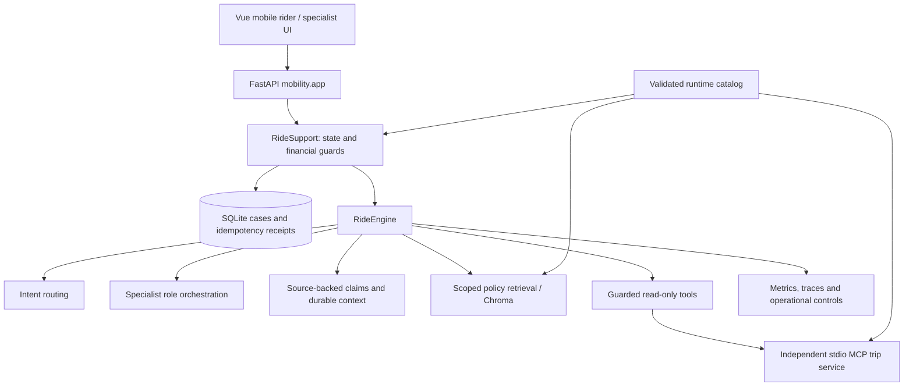

# Architecture

## Request path

`backend/mobility/app.py` is the active product entry point. The separate Java service does not serve the mobile ride workflow.

## Ownership

- The catalog owns fictional recorded trips, settled/pending payment records and policy scopes. Payment amounts use integer cents. Startup validation rejects inconsistent settled totals, missing policy references and extra label fields.
- The case store owns rider identity, conversation, evidence, history, handoff and simulated adjustments. Case transitions and idempotency receipts are committed transactionally.
- Memory distinguishes rider assertions, withdrawn claims and recorded tool facts. Evidence attachments remain unverified; upload does not establish truth.
- The engine requests information through read-only tools. Agent text does not itself execute a financial action. Explicit rider confirmation and server-side state validation guard simulated adjustments.
- The independent MCP process loads the same catalog as the API and exposes recorded trip information. Transport failures remain observable and can yield partial runs.
- Knowledge is indexed by the trip's policy scope and includes policy version text. It uses local hash features in no-key mode, not neural embeddings.
- The replay driver supplies HTTP-ready steps to the actual application. Its independent reference state machine reads event worlds separately. Oracle labels never enter runtime catalog or model inputs.

## Configuration and persistence

`KINDER_UBER_RIDE_MODEL_MODE=demo` enables the deterministic no-key model. Live provider mode is opt-in. `KINDER_UBER_RIDE_DB` selects the case database; `KINDER_UBER_RIDE_CATALOG_PATH` selects an immutable runtime release.

The macOS supervisor restarts failed local services and probes MCP separately. A synthetic preview runs against isolated storage. Existing local data is not a deployment artifact.

## Current limits

Single-node SQLite and in-process coordination do not provide distributed locking or multi-region availability. Demo identity headers and a public specialist credential are role-play controls. Correction parsing has finite English grammar; deterministic output cannot establish general reasoning quality. Evidence validation does not include receipt OCR or fraud detection. External payments and real ride-provider accounts are not connected.
