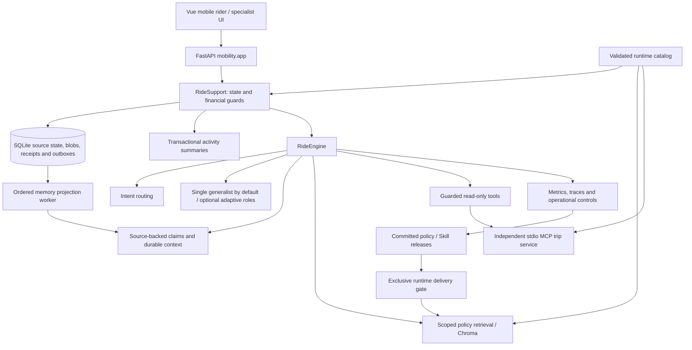

# Architecture

## Request path

`backend/mobility/app.py` is the active product entry point. The separate Java service does not serve the mobile ride workflow.

## Execution choice

Single agent with durable context is the default. The generalist receives the union of the same read-only tools and covers trip, billing and handoff concerns. In demo mode it shares the deterministic trip/billing renderers and sentence deduplication used by the single-agent baseline. It describes human review as available rather than assuming the rider requested it. Live mode uses one generalist prompt with those tools; offline evidence does not establish live-model quality.

Explicit `agent_mode=multi` restores adaptive specialist dispatch and composition. API selection is scoped to an owned case, included in command fingerprints and stored on each analysis. Switching changes the next analysis without deleting history, evidence or memory. New cases and pre-mode records default to single; omitted mode on follow-ups preserves an explicit case choice. Both modes use the unchanged durable memory implementation. Benchmark fixtures explicitly select their configuration so a default change cannot silently relabel an ablation.

## Ownership

- The catalog owns fictional recorded trips, settled/pending payment records and policy scopes. Payment amounts use integer cents. Startup validation rejects inconsistent settled totals, missing policy references and extra label fields. Existing case trips must remain available; an authenticated release cannot silently transfer their rider ownership. Operator discovery and diagnostics use the configured records and scopes rather than seed-only identifiers.
- The case store owns the authenticated rider subject, conversation, evidence, history, handoff and simulated adjustments. Case transitions and idempotency receipts are committed transactionally.
- Memory distinguishes rider assertions, withdrawn claims and recorded tool facts. Evidence attachments remain unverified; upload does not establish truth.
- The engine requests information through read-only tools. Agent text does not itself execute a financial action. Explicit rider confirmation and server-side state validation guard simulated adjustments.
- The independent MCP process loads the same catalog as the API and exposes recorded trip information. Transport failures remain observable and can yield partial runs.
- Knowledge is indexed by the trip's policy scope and includes policy version text. It uses local hash features in no-key mode, not neural embeddings.
- The replay driver supplies HTTP-ready steps to the actual application. Its independent reference state machine reads event worlds separately. Oracle labels never enter runtime catalog or model inputs.

## Configuration and persistence

`KINDER_UBER_RIDE_MODEL_MODE=demo` enables the deterministic no-key model. Live provider mode is opt-in. `KINDER_UBER_RIDE_DB` selects the case database; `KINDER_UBER_RIDE_CATALOG_PATH` selects an immutable runtime release.

The macOS supervisor distinguishes process liveness from dependency readiness. It restarts unresponsive/crashed services and recovers a persistently failed MCP owner without restarting a healthy backend merely because database/configuration readiness is degraded. Child output drains into bounded rotating logs in a private application directory. A synthetic preview runs against isolated storage. Existing local data is not a deployment artifact. Case memory and management releases commit canonical content and a delivery outbox before changing derived indexes/files. See [state and recovery](STATE_AND_RECOVERY.md) for revision, migration, cursor and backup contracts.

## Current limits

Single-node SQLite and in-process coordination do not provide distributed locking or multi-region availability. Default demo identity headers and a public specialist credential are role-play controls. The optional authenticated profile uses expiring opaque credentials and scoped roles; [security details](SECURITY.md) document its controls and limits. Correction parsing has finite English grammar; deterministic output cannot establish general reasoning quality. Evidence validation does not include receipt OCR or fraud detection. External payments and real ride-provider accounts are not connected.
